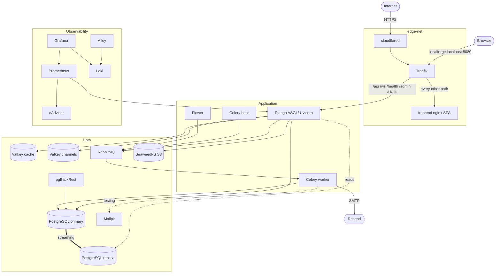

<div align="center">

# 🔨 LocalForge

## **A full-stack Django and React platform that runs on your own machine, with an optional public edge**

<!-- Project status -->
[](docs/handover/phase-12.md)
[](LICENSE)
[](CHANGELOG.md)
[](#-testing)
[](#-testing)
[](#-testing)
[](COMMIT_CONVENTION.md)

<!-- Backend -->
[](https://www.python.org/)
[](https://www.djangoproject.com/)
[](https://www.django-rest-framework.org/)
[](https://channels.readthedocs.io/)
[](https://www.uvicorn.org/)
[](https://docs.celeryq.dev/)
[](https://docs.astral.sh/uv/)

<!-- Frontend -->
[](https://react.dev/)
[](https://www.typescriptlang.org/)
[](https://tailwindcss.com/)
[](https://vite.dev/)
[](https://vitest.dev/)
[](https://playwright.dev/)
[](https://pnpm.io/)

<!-- Platform -->
[](https://www.docker.com/)
[](https://www.postgresql.org/)
[](https://valkey.io/)
[](https://www.rabbitmq.com/)
[](https://github.com/seaweedfs/seaweedfs)
[](https://traefik.io/)
[](https://developers.cloudflare.com/cloudflare-one/connections/connect-networks/)
[](https://resend.com/)

<!-- Observability -->
[](https://prometheus.io/)
[](https://grafana.com/)
[](https://grafana.com/oss/loki/)
[](https://grafana.com/oss/alloy-opentelemetry-collector/)

<!-- Quality -->
[](https://docs.astral.sh/ruff/)
[](https://mypy-lang.org/)
[](https://pytest.org/)
[](docs/adr/0014-sops-age-secrets.md)

**One repository, one command, a complete platform: REST API, WebSockets, background workers, object storage, mail,
monitoring, logging, backups, replication, a React single-page app, and an optional public HTTPS edge.**

[Features](#-key-features) • [Architecture](#-architecture) • [Quick start](#-quick-start) •
[Domain setup](#-public-domain-cloudflare-tunnel-and-resend-email) • [API](#-api-surface) • [Testing](#-testing) •
[Documentation](#-documentation-map)

</div>

---

## 📋 Overview

**LocalForge** is a full-stack reference platform. A **Django 6** backend serves a deliberately small, fully documented
REST and WebSocket surface, a **React 19 and Tailwind CSS 4** single-page application consumes it, and a
**containerized infrastructure** underneath provides everything a real deployment needs: a primary and a replica
database, cache, message broker, channel layer, object storage, mail capture, a reverse proxy, metrics, logs, backups,
and dashboards. All of it runs in Docker on one machine with no cloud dependency.

The platform is **offline by default**. Only image pulls, image builds, and dependency resolution touch the network.
Two approved external boundaries exist and are optional to use: a **Cloudflare Tunnel** that publishes the app on your
own domain over HTTPS, and **Resend** for real transactional email. Everything else, including every dashboard, stays
on loopback.

> [!NOTE]
> **Status: Locally Verified.** The backend is frozen and fully gated; the frontend is built, tested, and part of the
> committed development stack. Production readiness is deliberately not claimed. See the
> [Phase 12 handover](docs/handover/phase-12.md) for the evidence and the remaining unverified gates.

## ✨ Key features

### 🔐 **Accounts and authentication**

- **First-party account API**: registration, activation, resend activation, password and username change, and
  recovery flows ([ADR 0017](docs/adr/0017-first-party-account-endpoints.md))
- **Browser sign-in** with `HttpOnly`, `Secure`, `SameSite=Strict` cookie JWTs, double-submit CSRF, and `__Host-`
  cookie prefixes, so credentials never reach JavaScript ([ADR 0025](docs/adr/0025-browser-authentication.md))
- **Bearer JWT and token auth** for non-browser clients, with refresh and verify
- **Argon2** password hashing, enumeration-resistant responses, and constant-minimum response durations
- **Tiered, cache-backed throttling** on every authentication and recovery route

### 🔔 **Real-time**

- **Authenticated notification WebSocket** over Django Channels on a dedicated Valkey
- Cookie or subprotocol credentials, exact Origin and Host validation, size limits, and a documented close code for
  every outcome ([WebSocket contract](docs/api/websocket-v1.md))
- Per-user event fan-out driven by Celery

### ⚙️ **Asynchronous work**

- **Celery** worker and **django-celery-beat** scheduler on **RabbitMQ** quorum queues with publisher confirms
- Email delivery, scheduled credential cleanup, and a **Flower** dashboard

### 🏗️ **Platform**

- **PostgreSQL 18** primary with a streaming **hot-standby replica** and **pgBackRest** scheduled backups
- **Valkey** for cache and Celery results, and a separate **Valkey** for the channel layer
- **SeaweedFS** S3-compatible object storage
- **Traefik** edge with Docker label discovery; Django owns `/api/`, `/ws/`, `/health/`, `/admin/`, `/static/`
- **Cloudflare Tunnel** public edge and **Resend** email on your own domain (optional)

### 📊 **Observability**

- **Prometheus** metrics from Django, PostgreSQL, both Valkeys, RabbitMQ, and every container (cAdvisor)
- **Loki** logs collected by **Grafana Alloy**, structured JSON, viewed in **Grafana**
- A project-scoped **Docker audit**, **convention audit**, and **security audit** that fail closed

### 🎨 **Frontend**

- **React 19.3**, **TypeScript**, **Tailwind CSS 4.3**, **React Router 8**, **TanStack Query**, **React Hook Form**,
  and **Zod**, bundled by **Vite**
- A typed API client generated from the committed OpenAPI document and checked for drift
- WCAG-minded UI verified with **axe-core** and **Playwright** browser journeys
- Served as a static, non-root, read-only **nginx** container on the same origin as the API
  ([ADR 0027](docs/adr/0027-frontend-hosting-and-edge-routing.md))

### 🛡️ **Engineering standards**

- **100% branch coverage**, Ruff `select = ["ALL"]`, **mypy strict**, and **ty**
- **No comments**: every explanation is a structured docstring, enforced by a checker
  ([ADR 0020](docs/adr/0020-no-comments-structured-docstrings.md))
- Pinned versions only; secrets generated, never typed; **SOPS and age** for committed encrypted env files
- Tests run **in parallel** and must pass **in a container and on the host**

---

## 🧱 Architecture



**Routing in one sentence:** Django owns `/api/`, `/ws/`, `/health/`, `/admin/`, and `/static/` at Traefik priority 100,
and the frontend is the fallback for every other path at priority 10, so a frontend failure can never take the API
down. Public `/admin/` is blocked at the edge.

### Environments

There are exactly two, and there is no third.

| Environment | Compose project | Purpose | Services |
| --- | --- | --- | --- |
| `development` | `localforge-dev` | Full stack, every dashboard, the public edge | 24 |
| `testing` | `localforge-test` | Headless subset the test suite needs | 6, plus Mailpit during a run |

`testing` must pass **in a container and on the host**. One passing is not a pass.

---

## 🔧 Tech stack

### **Backend**

| Technology | Version | Purpose |
| --- | --- | --- |
| Python | 3.14.6 | Language |
| Django | 6.0.8 | Web framework |
| Django REST framework | 3.18.0 | REST layer |
| drf-spectacular | 0.30.0 | OpenAPI, Swagger UI, ReDoc |
| SimpleJWT | 5.5.1 | JWT issuing and verification |
| Channels, channels-redis | 4.3.2, 4.3.0 | WebSockets and the channel layer |
| Uvicorn | 0.52.4 | ASGI server |
| Celery, django-celery-beat | 5.6.3, 2.9.0 | Tasks and scheduling |
| Flower | 2.1.0 | Celery dashboard |
| psycopg | 3.3.5 | PostgreSQL driver with pooling |
| django-storages, boto3 | 1.14.6, 1.40 | S3 object storage |
| argon2-cffi | 25.1.0 | Password hashing |
| django-prometheus | 2.5.0 | Application metrics |

### **Frontend**

| Technology | Version | Purpose |
| --- | --- | --- |
| React, React DOM | 19.3.0 | UI library |
| TypeScript | 5.9.3 | Language |
| Tailwind CSS | 4.3.3 | Styling |
| Vite | 8.3.2 | Build tool |
| React Router | 8.4.0 | Routing |
| TanStack Query | 5.104.1 | Server state |
| React Hook Form, Zod | 7.89.0, 4.6.5 | Forms and validation |
| Vitest, Testing Library | 5.0.3, 16.3.3 | Unit and component tests |
| Playwright, axe-core | 1.63.0, 4.13.0 | Browser journeys and accessibility |
| ESLint, Prettier | 10.12.0, 3.9.9 | Lint and format |
| Node.js, pnpm | 24.20.0, 11.21.0 | Runtime and package manager |
| nginx (unprivileged) | 1.30.4 | Static hosting in the container |

### **Platform**

| Technology | Version | Purpose |
| --- | --- | --- |
| PostgreSQL | 18.6 | Primary database and hot standby |
| pgBackRest | 2.59.1 | Backups |
| Valkey | 9.1.2 | Cache, Celery results, channel layer |
| RabbitMQ | 4.3.5 | Celery broker |
| SeaweedFS | 4.46 | Object storage |
| Mailpit | v1.31.1 | SMTP capture |
| Traefik | v3.7.13 | Reverse proxy |
| cloudflared | 2026.9.3 | Cloudflare Tunnel connector |
| pgAdmin | 9.17 | Database dashboard |

### **Observability**

| Technology | Version | Purpose |
| --- | --- | --- |
| Prometheus | v3.14.0 | Metrics |
| Grafana OSS | 13.0.2 | Dashboards |
| Loki | 3.7.7 | Log storage |
| Grafana Alloy | v1.19.2 | Log collection |
| cAdvisor | v0.60.5 | Container metrics |
| postgres-exporter, redis_exporter | v0.20.1, v1.91.1 | Database and Valkey metrics |

### **Quality and security**

| Technology | Version | Purpose |
| --- | --- | --- |
| Ruff | 0.16.6 | Lint and format, all rules |
| mypy, ty | 2.3.1, 0.0.78 | Strict type checking |
| pytest | 9.1.1 | Tests, 100% branch coverage |
| SOPS, age | 3.13.3, 1.3.2 | Encrypted environment files |
| pre-commit, markdownlint, yamllint | pinned | Repository hygiene |

Every tool choice, with dated primary-source evidence, is recorded in [docs/adr/](docs/adr/README.md). Four defaults are
deliberately reversed: **MinIO is unusable** (SeaweedFS), **Promtail is end of life** (Alloy), **Djoser is not
adopted**, and **Valkey replaces Redis** on licence grounds.

---

## 📁 Project structure

```text
localforge/
├── backend/                     # Django project, Python metadata, tests, operator scripts
│   ├── src/
│   │   ├── config/              # Settings split, URLs, ASGI routing, health, throttling, logging
│   │   ├── accounts/            # User model and the first-party account endpoints
│   │   ├── notifications/       # WebSocket consumer, authentication, admission, delivery
│   │   └── manage.py
│   ├── scripts/                 # manage_platform, gen_secrets, audits, developer-access export
│   ├── tests/                   # unit and integration layers
│   ├── pyproject.toml           # Dependencies, Poe tasks, Ruff, mypy, pytest
│   └── uv.lock
├── frontend/                    # React and Tailwind single-page application
│   ├── src/
│   │   ├── api/                 # Typed client, CSRF, errors, WebSocket, generated schema types
│   │   ├── features/            # auth, account, credentials, recovery, notifications, shell
│   │   ├── routes/              # Route table and guards
│   │   ├── session/             # Session provider and fragment credentials
│   │   └── ui/                  # Shared accessible components
│   ├── e2e/                     # Playwright journeys against the testing backend
│   ├── scripts/                 # Bundle, docs, supply-chain, and image checks
│   └── package.json
├── docker/                      # Dockerfiles and service configuration (django, frontend, traefik, ...)
├── docs/
│   ├── adr/                     # 28 architecture decision records
│   ├── api/                     # OpenAPI document and the WebSocket contract
│   ├── architecture/            # Phase specs and the SOLID audit
│   ├── build/                   # Prerequisites and the build plan
│   ├── handover/                # Per-phase evidence and unverified gates
│   ├── platform/                # Conventions, service inventory, standards, Kubernetes mapping
│   ├── runbooks/                # Public edge and email, restore drill, frontend deploy and rollback
│   └── security/                # Security audit and image vulnerability policy
├── .scratch/                    # The 99-ticket build index
├── compose.yaml                 # Shared Compose base
├── compose.development.yaml     # The 24-service development stack
├── compose.testing.yaml         # The headless testing stack
├── compose.proxy-only.yaml      # Variant that omits the direct Django port 8000
├── .env.example                 # Placeholder environment template (never real values)
├── Makefile                     # Root operator interface
└── AGENTS.md  CONTEXT.md  CONTRIBUTING.md  SECURITY.md  ...
```

---

## 🚀 Quick start

### Requirements

| Tool | Minimum | Notes |
| --- | --- | --- |
| Docker Engine and Compose | 27.0 and 2.24 | Docker Desktop on Windows or macOS is fine |
| Python | 3.14 | Managed by `uv`; bare `python` on `PATH` is not used |
| `uv` | 0.5 | Python environment and dependency manager |
| GNU Make | 3.81 | The root operator interface |
| Node.js and `pnpm` | 24 LTS and 11.21.0 | Only for frontend work outside Docker |
| SOPS and age | 3.13 and 1.3 | Only to decrypt committed `.env.*.sops` files |
| Resources | 4 CPU, 8 GiB RAM, 20 GiB disk | The full stack runs roughly 30 containers |

`make setup` checks all of this and prints a pass or fail table. The full list, with install commands, is in
[docs/build/prerequisites.md](docs/build/prerequisites.md).

### 1. Clone and install

```console
git clone https://github.com/DataRohit/LocalForge.git
cd LocalForge
make sync
make help
```

### 2. Create your environment files

The committed `.env.*.sops` files are encrypted to the author's age key, so on your own machine you generate fresh
credentials instead:

```console
make secrets-generate
```

This creates `.env.development`, `.env.testing`, and `.env.testing.host` from `.env.example`. Every secret is
generated, a different one per service, and nothing existing is ever overwritten. Never type a secret yourself or put
one in a command, document, or commit.

### 3. Fill in the two provider values

`.env.development` has two placeholders for external services:

| Variable | Needed for | Where to get it |
| --- | --- | --- |
| `TUNNEL_TOKEN` | The `cloudflared-cf7q2` container, which publishes the app on your domain | [Cloudflare Tunnel setup](#2-create-the-cloudflare-tunnel) |
| `RESEND_API_KEY` | Real email delivery from the Celery worker | [Resend setup](#3-set-up-resend-for-email) |

Open the file in an editor, replace only those two `<GENERATED>` values, save, and rerun the generator so it can derive
the dependent value:

```console
make secrets-generate
```

> [!IMPORTANT]
> The development stack includes `cloudflared` as a service, and it cannot become healthy without a valid tunnel
> token. Follow the [domain setup](#-public-domain-cloudflare-tunnel-and-resend-email) before the first start, or the
> health gate will report that container. `testing` needs neither value.

### 4. Build and start both environments

```console
make environments-setup
```

On Windows, or anywhere else another process already owns port 8000, publish through Traefik only:

```console
make environments-setup ARGS="--proxy-only"
```

This pulls missing pinned images, builds the local images (`django`, `django-test`, `frontend`, `pgbackrest`) through
cached deterministic layers, starts both Compose projects, waits for readiness, and audits Docker ownership. It never
runs application tests.

### 5. Open it

| What | URL |
| --- | --- |
| **The app** (frontend) | `http://localforge.localhost:8080/` |
| Swagger UI | `http://localforge.localhost:8080/api/schema/swagger-ui/` |
| ReDoc | `http://localforge.localhost:8080/api/schema/redoc/` |
| Health | `http://localforge.localhost:8080/health/` |
| Public app (after domain setup) | `https://<your-subdomain>.<your-domain>/` |

Operator dashboards are loopback-only and protected by generated credentials:

| Dashboard | URL |
| --- | --- |
| Grafana (metrics and logs) | `http://127.0.0.1:3000` |
| Traefik dashboard | `http://127.0.0.1:8081/dashboard/` |
| pgAdmin | `http://127.0.0.1:5050` |
| Flower (Celery) | `http://127.0.0.1:5555` |
| RabbitMQ management | `http://127.0.0.1:15672` |
| Mailpit (captured mail) | `http://127.0.0.1:8025` |
| Django direct | `http://127.0.0.1:8000` (omitted with `--proxy-only`) |

Generate browser bookmarks and a password-manager import for every dashboard:

```console
make developer-access-export
```

It writes `bookmarks.html` and `passwords.csv` to the repository root. Both are git-ignored; treat `passwords.csv` as a
secret and delete it once imported.

### 6. Verify the running stack

```console
make development-health
make testing-health
make docker-audit
```

---

## 🌐 Public domain, Cloudflare Tunnel, and Resend email

This section takes you from a bare domain to the app live on `https://localforge.example.com` with real email. The
platform ships configured for the author's domain, `localforge.datarohit.com`; you replace that with yours.

What you are building:

```text
 Browser ──HTTPS──▶ Cloudflare edge ──Tunnel──▶ cloudflared ──▶ Traefik ──▶ frontend / Django
                       (TLS, DNS)             (outbound only)    (internal)

 Celery worker ──SMTP :587──▶ Resend ──▶ recipient inbox   (DKIM, SPF, DMARC on your subdomain)
```

- **No inbound ports are opened.** `cloudflared` dials out to Cloudflare, so your router and firewall stay untouched.
- **TLS is terminated by Cloudflare.** Traefik inside Docker speaks plain HTTP and sets `X-Forwarded-Proto: https`.
- **Only the application is public.** Dashboards, databases, brokers, and `/admin/` are never routed to the internet.

### Prerequisites

- A domain whose DNS is managed by **Cloudflare** (a free plan is enough). Move your nameservers to Cloudflare first and
  wait for the zone to show **Active**.
- A [Cloudflare](https://dash.cloudflare.com/) account with **Zero Trust** enabled (the free plan works).
- A [Resend](https://resend.com/) account.
- Decide on one hostname. These steps use **`localforge.example.com`**, a subdomain of your domain `example.com`.
  A dedicated subdomain keeps email reputation and DNS records separate from the rest of your domain.

> [!TIP]
> Dashboard menu names change over time. If a label below differs slightly, search the Cloudflare or Resend
> documentation for the same concept; the settings themselves are stable.

### 1. Choose your hostname

Pick the hostname once and use it everywhere. In the rest of this guide:

| Placeholder | Example | Meaning |
| --- | --- | --- |
| `<PUBLIC_HOST>` | `localforge.example.com` | Where users open the app and where the Tunnel points |
| `<MAIL_DOMAIN>` | `localforge.example.com` | Domain Resend verifies; the sender is `no-reply@<MAIL_DOMAIN>` |
| `<SUPPORT_EMAIL>` | `support@example.com` | Reply-to address and the dashboard admin login |

### 2. Create the Cloudflare Tunnel

1. In the Cloudflare dashboard open **Zero Trust → Networks → Tunnels** and choose **Create a tunnel**.
2. Select the **Cloudflared** connector and name the tunnel, for example `localforge-public`.
3. On the install screen, **copy only the token**. It is the long string after `--token` or `service install`.
   Do not run the installer command: this project runs `cloudflared` in Docker for you.
4. Continue to **Public Hostname** (sometimes called **Published application routes**) and add exactly one route:

   | Field | Value |
   | --- | --- |
   | Subdomain | `localforge` |
   | Domain | `example.com` |
   | Path | leave empty |
   | Service type | `HTTP` |
   | URL | `traefik-tk2jp:80` |

   `traefik-tk2jp` is the Traefik container name on the internal `edge-net-ne2vk` network, which `cloudflared` joins.
   Do not use `localhost`: inside the container it points at `cloudflared` itself.
5. Save. Cloudflare creates the proxied `CNAME` for `<PUBLIC_HOST>` pointing at your tunnel automatically. Leave that
   record exactly as the provider created it. Never write a `cfargotunnel.com` name by hand and never replace it with
   an `A` record to your own IP.
6. Do not add public hostnames for Grafana, pgAdmin, Mailpit, RabbitMQ, Flower, or any database. They must stay private.

Put the token in `.env.development` through an editor, never on a command line:

```text
TUNNEL_TOKEN=<paste the token here>
```

### 3. Set up Resend for email

1. In Resend open **Domains → Add Domain** and enter `<MAIL_DOMAIN>` (`localforge.example.com`). Choose the region
   closest to you.
2. Resend shows the DNS records it needs, typically a **DKIM** `TXT` record (`resend._domainkey.localforge`) and the
   records for the sending subdomain (for example `send.localforge`). Add **exactly** what the dashboard shows, in
   Cloudflare under **DNS → Records**.
3. For every record Resend gives you, set the Cloudflare proxy status to **DNS only** (grey cloud). Proxied mail records
   break verification.
4. Back in Resend choose **Verify DNS Records** and wait for the domain to show **Verified**. DNS can take a few
   minutes.
5. Under **API Keys** create a key with **Sending access** restricted to `<MAIL_DOMAIN>`. A domain-scoped key limits the
   damage if it ever leaks. Copy it once; Resend will not show it again.
6. Put it in `.env.development` through an editor:

   ```text
   RESEND_API_KEY=<paste the key here>
   ```

7. Add a DMARC record so receivers can authenticate your mail. In Cloudflare DNS add one **DNS-only** `TXT` record:

   | Type | Name | Content |
   | --- | --- | --- |
   | `TXT` | `_dmarc.example.com` | `v=DMARC1; p=none; rua=mailto:<SUPPORT_EMAIL>` |

   Start with `p=none` to observe reports, review them for a couple of weeks, and only then move to `quarantine` or
   `reject` once alignment is proven.

How the project sends mail:

| Setting | Value | Set by |
| --- | --- | --- |
| `EMAIL_HOST` | `smtp.resend.com` | generator default |
| `EMAIL_PORT` | `587` | generator default |
| `EMAIL_HOST_USER` | `resend` | generator default |
| `EMAIL_HOST_PASSWORD` | your `RESEND_API_KEY` | derived by `make secrets-generate` |
| `EMAIL_USE_TLS` | `true` | generator default |
| `DEFAULT_FROM_EMAIL` | `LocalForge <no-reply@<MAIL_DOMAIN>>` | **you edit** |
| `DEFAULT_REPLY_TO_EMAIL` | `<SUPPORT_EMAIL>` | **you edit** |

`testing` always uses Mailpit and never needs Resend.

### 4. Point the application at your hostname

The canonical hostname is written in a small number of places. Replace `localforge.datarohit.com` with
`<PUBLIC_HOST>` in each, then replace the mail and admin addresses.

**a. Environment file** (`.env.example` before the first `make secrets-generate`, or `.env.development` afterwards):

```text
DJANGO_ALLOWED_HOSTS=localhost,127.0.0.1,localforge.localhost,localforge.example.com,django-uv5n2,django-metrics-nb4xt
DJANGO_CSRF_TRUSTED_ORIGINS=http://localhost:8080,http://localforge.localhost:8080,https://localforge.example.com
DJANGO_CORS_ALLOWED_ORIGINS=http://localhost:8080,http://localforge.localhost:8080,https://localforge.example.com
DJANGO_SITE_URL=https://localforge.example.com
DEFAULT_FROM_EMAIL=LocalForge <no-reply@localforge.example.com>
DEFAULT_REPLY_TO_EMAIL=support@example.com
CLOUDFLARED_TUNNEL_NAME=localforge-public
PGADMIN_DEFAULT_EMAIL=support@example.com
GRAFANA_ADMIN_USER=support@example.com
```

`DJANGO_SITE_URL` is the origin placed in activation and recovery links inside emails, so a wrong value produces links
that go nowhere. `DJANGO_CSRF_TRUSTED_ORIGINS` must contain the exact `https://` origin or browser sign-in fails with a
CSRF error.

**b. Traefik routers** in `compose.development.yaml`. Two rules name the public host:

```text
traefik.http.routers.localforge-public.rule=Host(`localforge.example.com`) && (PathPrefix(`/api/`) || ...)
traefik.http.routers.frontend-public.rule=Host(`localforge.example.com`)
```

**c. Secure-cookie host** in `backend/src/config/security.py`, which marks cookies `Secure` for the canonical public
host:

```python
if request.get_host() == "localforge.example.com" and request.is_secure():
```

**d. Generator defaults** in `backend/scripts/gen_secrets.py`: `DEFAULT_FROM_EMAIL`, `DEFAULT_REPLY_TO_EMAIL`, and
`BASIC_AUTH_USER`. They seed new environment files, so edit them if you want fresh files to match.

Find every remaining occurrence, including tests that pin the canonical host:

```console
git grep -n "datarohit"
```

> [!WARNING]
> The unit tests assert the author's canonical hostname and addresses (`tests/unit/config/`, `tests/unit/compose/`,
> `tests/unit/scripts/`). After renaming, update those expectations in the same change and run `make check`. A fork
> that skips this will see `make check` fail on the old hostname, which is the gate doing its job. Do not edit the
> quality gate to make it pass.

### 5. Start and verify

Recreate the containers so they read the new environment and labels. This preserves all data:

```console
make development-rebuild
make development-health
```

Confirm the tunnel connected:

```console
docker logs cloudflared-cf7q2 --tail 20
```

You should see registered tunnel connections and no authentication errors. Then check each layer:

| Check | Command | Expect |
| --- | --- | --- |
| DNS resolves through Cloudflare | `nslookup localforge.example.com 1.1.1.1` | Cloudflare addresses, not your IP |
| Frontend loads | `curl -sI https://localforge.example.com/` | `200` and security headers |
| API health | `curl -s https://localforge.example.com/health/` | `ready` with all checks working |
| Admin is blocked publicly | `curl -sI https://localforge.example.com/admin/` | not `200` |
| Dashboards are not public | `curl -s https://localforge.example.com/dashboard/` | the SPA page, never the Traefik dashboard |

Then prove email end to end: open the app, **Register** with an address you own, and confirm the activation message
arrives. Open the message's full headers and require **SPF, DKIM, and DMARC all `pass`**. In Resend, `Delivered` alone
does not prove inbox placement. Look in spam too, especially in the first days of a new sending domain.

### Troubleshooting

| Symptom | Likely cause | Fix |
| --- | --- | --- |
| `cloudflared-cf7q2` unhealthy or restarting | Missing or wrong `TUNNEL_TOKEN` | Replace the token, `make development-rebuild` |
| Cloudflare error 1033 or 502 | Tunnel service URL wrong, or Traefik down | Service must be `HTTP` `traefik-tk2jp:80`; check `make development-status` |
| Site returns `404 page not found` | Host header does not match a Traefik rule | Router hosts must equal `<PUBLIC_HOST>` exactly |
| `400 Bad Request` from Django | Host missing from `DJANGO_ALLOWED_HOSTS` | Add the hostname and rebuild |
| Sign-in fails with a CSRF error | `https://<PUBLIC_HOST>` missing from `DJANGO_CSRF_TRUSTED_ORIGINS` | Add the exact origin and rebuild |
| Cookies not `Secure` on the public host | Hostname in `security.py` still the author's | Edit it and rebuild the image |
| Resend domain stuck on pending | Records proxied or mistyped | Set DNS only, copy values exactly, verify again |
| `535` authentication failure from SMTP | Wrong or revoked `RESEND_API_KEY` | Create a new domain-scoped key, update, rebuild |
| Mail lands in spam | New domain, or a failing SPF, DKIM, or DMARC | Read the received headers; wait for reputation to build |
| Links in emails point to the wrong host | `DJANGO_SITE_URL` | Set it to `https://<PUBLIC_HOST>` and rebuild |

### Rotation and rollback

- **Rotate the tunnel token**: disable the route, revoke the old token in Cloudflare, put the new one in
  `.env.development`, run `make development-rebuild`, confirm the tunnel is healthy, then re-enable the route.
- **Rotate the Resend key**: create a replacement domain-scoped key, install it, rebuild, send a controlled message, and
  only then revoke the old key. Treat any exposed key as compromised and revoke it immediately.
- **Take the site offline**: disable the Tunnel route in Cloudflare. The local stack keeps working unchanged.
- **Roll back the frontend only**: see [the rollback runbook](docs/runbooks/frontend-deployment/rollback.md).

The complete operator sequence, including apex and `www` redirect rules, is in the
[public edge and email runbook](docs/runbooks/phase-9-public-edge-email.md) and the
[public edge ADR](docs/adr/0022-public-edge-and-resend.md).

---

## 📡 API surface

The application surface is **fixed**: these routes and no others. Every route documents every status code it can
return, including those raised by middleware, content negotiation, throttling, and CSRF, with a response example for each
([ADR 0018](docs/adr/0018-api-error-contract.md)). The OpenAPI document is committed at
[docs/api/openapi-v1.yaml](docs/api/openapi-v1.yaml).

### **Health**

```http
GET    /health/                                   # Aggregate readiness; what the load balancer polls
```

### **Accounts**

```http
POST   /api/v1/users/                             # Register
GET    /api/v1/users/me/                          # Current user (also PUT, PATCH, DELETE)
POST   /api/v1/users/resend_activation/           # Resend the activation email
POST   /api/v1/users/set_password/                # Change password
POST   /api/v1/users/reset_password/              # Request a password reset
POST   /api/v1/users/reset_password_confirm/      # Confirm a password reset
POST   /api/v1/users/set_username/                # Change username
POST   /api/v1/users/reset_username/              # Request a username reset
POST   /api/v1/users/reset_username_confirm/      # Confirm a username reset
```

### **Browser authentication** (cookies, CSRF, same origin)

```http
GET    /api/v1/browser/csrf/                      # Seed the CSRF cookie
POST   /api/v1/browser/login/                     # Sign in, set HttpOnly cookies
POST   /api/v1/browser/refresh/                   # Rotate the cookie pair
POST   /api/v1/browser/logout/                    # Blacklist refresh, clear cookies
```

### **Bearer authentication** (non-browser clients)

```http
POST   /api/v1/token/login/                       # Token login
POST   /api/v1/token/logout/                      # Token logout
POST   /api/v1/jwt/create/                        # Issue an access and refresh pair
POST   /api/v1/jwt/refresh/                       # Refresh
POST   /api/v1/jwt/verify/                        # Verify
```

### **Documentation** (enabled in development)

```http
GET    /api/schema/                               # OpenAPI document
GET    /api/schema/swagger-ui/                    # Swagger UI
GET    /api/schema/redoc/                         # ReDoc
```

### **WebSocket**

```http
WS     /ws/notifications/                         # Authenticated notification socket
```

The socket authenticates with the browser's `HttpOnly` cookie or with a JWT in the subprotocol header, never the query
string. Every close code is documented in the [WebSocket contract](docs/api/websocket-v1.md).

### **Errors**

Every error uses one envelope, so clients handle failures in one place. See
[ADR 0018](docs/adr/0018-api-error-contract.md).

---

## 🎨 Frontend

The single-page application lives in `frontend/` and follows [the frontend standard](docs/platform/frontend-standard.md)
for layout, components, Tailwind, accessibility, state ownership, and API access.

| Path | Page |
| --- | --- |
| `/sign-in`, `/register` | Authentication |
| `/activate`, `/resend-activation` | Account activation |
| `/forgot-password`, `/reset-password` | Password recovery |
| `/forgot-username`, `/reset-username` | Username recovery |
| `/account` | Profile and account deletion |
| `/account/password`, `/account/username` | Credential changes |
| `/notifications` | Live notifications over the WebSocket |

Design decisions worth knowing:

- **Same origin.** The SPA and API share one origin through Traefik, so the browser needs no CORS and credentials stay
  in `HttpOnly` cookies.
- **No frontend server.** It is static files behind nginx: no server-side rendering and no backend-for-frontend.
- **Typed from the schema.** API types are generated from the committed OpenAPI document and checked for drift.
- **Hardened image.** Non-root user `101:101`, read-only filesystem, all capabilities dropped, a strict CSP, and no
  hosted runtime dependency or telemetry.

Frontend commands run through the root Makefile and use pnpm only (never npm):

```console
make frontend-install        # pnpm install --frozen-lockfile
make frontend-check          # format, lint, types, docs standard, tests, build
make frontend-e2e            # Playwright journeys against the testing backend
make frontend-api-generate   # Regenerate API types from the OpenAPI document
make frontend-image          # Build the container image
make frontend-image-check    # Prove headers, caching, health, logging, routing, and rollback
make frontend-audit          # Licence, advisory, install-hook, and release-age audit
```

---

## 🕹️ Operating the platform

Run `make help` for the full categorized list.

| Workflow | Development | Testing |
| --- | --- | --- |
| Prepare both | `make environments-setup` | `make environments-setup` |
| Start | `make development-up` | `make testing-up` |
| Rebuild, preserve data | `make development-rebuild` | `make testing-rebuild` |
| Status | `make development-status` | `make testing-status` |
| Health | `make development-health` | `make testing-health` |
| Recent logs | `make development-logs` | `make testing-logs` |
| Follow one service | `make development-logs ARGS="--follow django-uv5n2"` | `make testing-logs ARGS="--follow postgres-tp8vn"` |
| Stop, preserve data | `make development-down` | `make testing-down` |
| **Destructive reset** | `make development-reset` | `make testing-reset` |

> [!CAUTION]
> The reset commands delete that environment's named volumes (database, uploads, dashboards) and rebuild without cache.
> They are deliberately separate from ordinary rebuilds. Never force the secret generator to regenerate values while
> existing volumes hold data initialized with the old ones.

| Command | Purpose |
| --- | --- |
| `make docker-audit` | Container, label, network, volume, image, and health inventory |
| `make docker-clean-check` | Fails if any LocalForge Docker resource exists (clean-room rehearsals only) |
| `make convention-audit` | Live comparison of names, ports, mounts, networks, and offline probes |
| `make security-audit` | Deployment, secret history, dependency, image, dashboard, and log gates |
| `make secrets-decrypt` | Restore plaintext env files from the committed encrypted ones (needs the age key) |
| `make developer-access-export` | Browser bookmarks and a password-manager import |

If port 8000 is taken, `--proxy-only` is accepted by `environments-setup`, `development-up`, `development-rebuild`,
and `development-reset`.

### Services and ports

All published ports bind to `127.0.0.1`. Names are assigned once in
[docs/platform/conventions.md](docs/platform/conventions.md) and must be copied verbatim.

| Service | Container | Host port |
| --- | --- | --- |
| Traefik web / dashboard | `traefik-tk2jp` | `8080` / `8081` |
| Frontend | `frontend-fe6vn` | none (via Traefik) |
| Cloudflare Tunnel | `cloudflared-cf7q2` | none (outbound only) |
| Django | `django-uv5n2` | `8000` |
| PostgreSQL primary / replica | `postgres-pg3ka` / `postgres-replica-pg6vy` | `5432` / `5433` |
| pgBackRest | `pgbackrest-pb2wj` | none |
| pgAdmin | `pgadmin-pa7fe` | `5050` |
| Valkey cache / channels | `valkey-cache-vc5tn` / `valkey-channels-vh8dm` | `6379` / `6380` |
| RabbitMQ AMQP / management | `rabbitmq-rq4sx` | `5672` / `15672` |
| Celery worker / beat | `celery-worker-cw8rt` / `celery-beat-cb4hq` | none |
| Flower | `flower-fl9zd` | `5555` |
| Mailpit SMTP / web | `mailpit-mp6gb` | `1025` / `8025` |
| SeaweedFS S3 | `seaweedfs-sw9cr` | `8333` |
| Prometheus, Loki, Alloy, cAdvisor, exporters | see the inventory | none (internal) |
| Grafana | `grafana-gf7qv` | `3000` |

The authoritative table, with networks and startup order, is the
[service inventory](docs/platform/service-inventory.md).

### Runtime truth

A passing test suite does not prove the running stack is healthy. After any service-facing change:

```console
make development-health
make testing-health
make docker-audit
make development-logs ARGS="django-uv5n2"
```

Exercise the changed behavior through its real seam, then inspect a bounded log window. Completion requires every
container running and healthy, `/health/` returning `ready`, the changed behavior succeeding through the deployed path,
and no unexplained `WARNING`, `ERROR`, or `CRITICAL` record. A `2xx` response must not log a failure.

---

## 🧪 Testing

Environment setup never runs tests. Test execution is explicit:

```console
make check                                   # Full backend gate: lint, types, docstrings, coverage, timing
make testing-test-container                  # Complete suite inside the test container
make testing-test-host                       # Complete suite from the host, plus registration stability
make testing-test-both                       # Both modes, with collection arithmetic
make testing-integration-audit               # Mailpit persistence and degraded-readiness audit
make frontend-check                          # Frontend gate
make frontend-e2e                            # Browser journeys
```

| Suite | Result at last full run |
| --- | --- |
| Backend, host and container | **2,303 passed**, 100% branch coverage, no source lines excluded |
| Security timing (credential and registration) | **23 passed**, plus five independent registration-stability runs |
| Frontend | **1,133 passed**, 100% coverage |
| Degraded-readiness audit | Passed in host and container modes |

Tests run in parallel and every service-touching test carries a timeout. A test that must run serially is marked and
justifies itself in its docstring. Integration tests must name the services they need so a failure points at the
unavailable service. Pytest warnings are errors and a skipped test is a failure.

Per-minute throttle tests wait out the end of a clock minute before starting, because the throttle counts in
epoch-aligned fixed windows. No limit is weakened to achieve this.

Focused runs, without the whole-suite coverage threshold:

```console
make test-unit
make test-integration
make test-security-timing
```

Reports are written to `htmlcov/index.html`, `coverage.xml`, and `test-results/`.

## 🔍 Code quality

```console
make lint            # Ruff
make format-check
make typecheck       # mypy strict and ty
make check           # everything above, plus tests
make pre-commit      # every repository hook
```

| Rule | Standard |
| --- | --- |
| Lint | Ruff with `select = ["ALL"]`, line length 100 |
| Types | mypy `strict` and `ty`, both must pass |
| Coverage | 100% branch coverage, enforced |
| Comments | None. Docstrings only, in three structured levels, checked mechanically |
| Markdown | markdownlint-cli2, 120-character lines outside tables and code |
| Frontend | ESLint with a zero-warning budget, Prettier, `tsc`, TSDoc blocks |
| Dependencies | Exact pins; `uv` for Python, `pnpm add --save-exact` for the frontend |

## 🔒 Security

- **Offline by default.** The stack needs no internet beyond image pulls and dependency resolution; services without a
  host port have internal-only networks and cannot reach the internet.
- **Loopback-only publications.** Every host port binds to `127.0.0.1`. Dashboards require generated credentials.
- **One credential per service**, all produced by `backend/scripts/gen_secrets.py`. `detect-private-key` and a
  full-history secret scan run in the gates.
- **Browser credentials never touch JavaScript.** `HttpOnly` cookies, `SameSite=Strict`, double-submit CSRF.
- **Enumeration-resistant recovery flows** with minimum response durations and per-address and per-account throttles.
- **Supply-chain audit** for licences, advisories, install hooks, and release age on both Python and pnpm
  dependencies, and an exact image vulnerability policy.
- **Documented, dated accepted risks** with review dates, in [the security audit](docs/security/security-audit.md).

To report a vulnerability, follow [SECURITY.md](SECURITY.md).

---

## 📚 Documentation map

`docs/` is authoritative for every tool choice, name, port, variable, and phase gate. When two documents disagree, the
more specific one wins, and the disagreement is fixed rather than chosen silently.

| Question | Document |
| --- | --- |
| What do the words mean? | [CONTEXT.md](CONTEXT.md) |
| Which tool, and why that one? | [docs/adr/](docs/adr/README.md) (28 decisions) |
| What are the names, IDs, ports, and variables? | [conventions](docs/platform/conventions.md), [service inventory](docs/platform/service-inventory.md) |
| What must be installed? | [prerequisites](docs/build/prerequisites.md) |
| What was built, in what order? | [build plan](docs/build/plan.md), [ticket index](.scratch/README.md) |
| How does the frontend work? | [frontend standard](docs/platform/frontend-standard.md), [Phase 12](docs/architecture/phase-12-frontend.md) |
| How is the backend frozen? | [Phase 11](docs/architecture/phase-11-backend-freeze.md) |
| How do I publish on my domain? | [Phase 9 runbook](docs/runbooks/phase-9-public-edge-email.md), [ADR 0022](docs/adr/0022-public-edge-and-resend.md) |
| How do I deploy and roll back the frontend? | [deploy](docs/runbooks/frontend-deployment/deploy.md), [rollback](docs/runbooks/frontend-deployment/rollback.md) |
| How do I restore from backup? | [restore drill](docs/runbooks/restore-drill.md) |
| What does the API return? | [OpenAPI](docs/api/openapi-v1.yaml), [WebSocket contract](docs/api/websocket-v1.md) |
| What is the security posture? | [security audit](docs/security/security-audit.md) |
| How would this become Kubernetes? | [Kubernetes mapping](docs/platform/kubernetes-mapping.md) (reasoning only) |
| What does a docstring need? | [documentation standard](docs/platform/documentation-standard.md) |
| What did each phase deliver? | [handovers](docs/handover/phase-12.md) for phases 7 to 12 |

## 🗺️ Build history

The project was built in twelve sequential phases, each gated on the previous one:

| Phase | Delivers |
| --- | --- |
| 1 | Infrastructure: every development service running and healthy |
| 2 | Project foundation: dependencies, settings split, standards, test layout, user model |
| 3 | Integration: Django wired to every service, `/health` live behind the proxy |
| 4 | REST API: the fixed route surface with every status code documented |
| 5 | WebSockets: authenticated sockets over the channel layer |
| 6 | Async services: worker, scheduler, dashboard, async email, event fan-out |
| 7 | Testing and audit: both modes in parallel, convention and security audits |
| 8 | SOLID architecture: evidence-led audit, focused improvements, final verification |
| 9 | Public edge and email: Cloudflare, Resend, DNS, runtime verification |
| 10 | Monorepo restructure: global root contract, backend subtree, clean-checkout gate |
| 11 | Backend freeze: test isolation, browser cookie auth, contract gaps |
| 12 | Frontend: React and Tailwind app, quality gates, container and edge routing, rollback |

## 🤝 Contributing

Contributions are welcome. Please read [CONTRIBUTING.md](CONTRIBUTING.md) first, and follow the
[commit convention](COMMIT_CONVENTION.md); a `commit-msg` hook validates it.

```console
make sync
make pre-commit-install   # enables pre-commit, commit-message, and pre-push hooks
make pre-commit           # validate the whole repository at any time
```

Pre-push runs mypy, ty, and the full test suite. The `.agents/` directory contains installed skills and is read-only.

| Policy | |
| --- | --- |
| [Contributing](CONTRIBUTING.md) | How to propose and land a change |
| [Commit convention](COMMIT_CONVENTION.md) | Conventional Commits with a fixed body format |
| [Code of Conduct](CODE_OF_CONDUCT.md) | Expected behavior |
| [Security policy](SECURITY.md) | Reporting vulnerabilities |
| [Support policy](SUPPORT.md) | Where to ask for help |
| [Governance](GOVERNANCE.md) | How decisions are made |
| [Changelog](CHANGELOG.md) | What changed |

## 📝 License

LocalForge is released under the [MIT License](LICENSE).

## 👤 Author

Rohit Vilas Ingole, creator and maintainer.

- GitHub: [@DataRohit](https://github.com/DataRohit)
- Repository: [DataRohit/LocalForge](https://github.com/DataRohit/LocalForge)
- Issues: [github.com/DataRohit/LocalForge/issues](https://github.com/DataRohit/LocalForge/issues)

---

<div align="center">

**Built to run on one machine, verified like it matters.**

⭐ Star the repository if LocalForge helps you.

</div>
